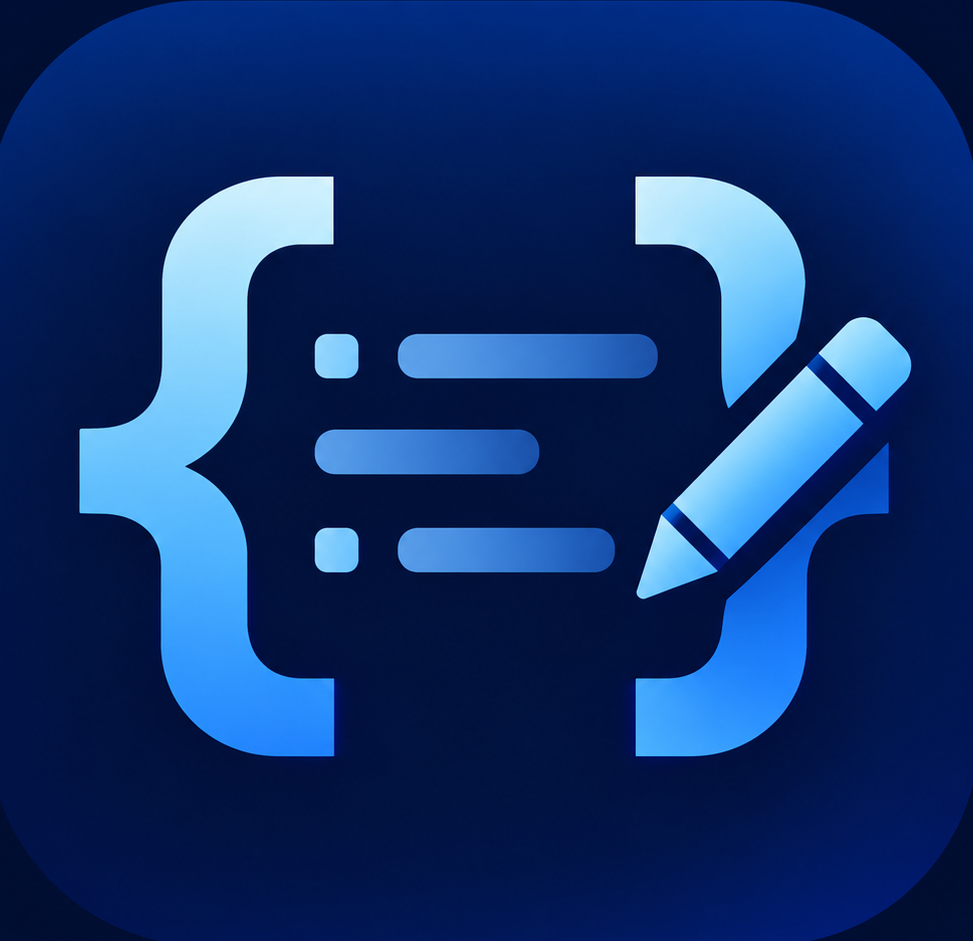
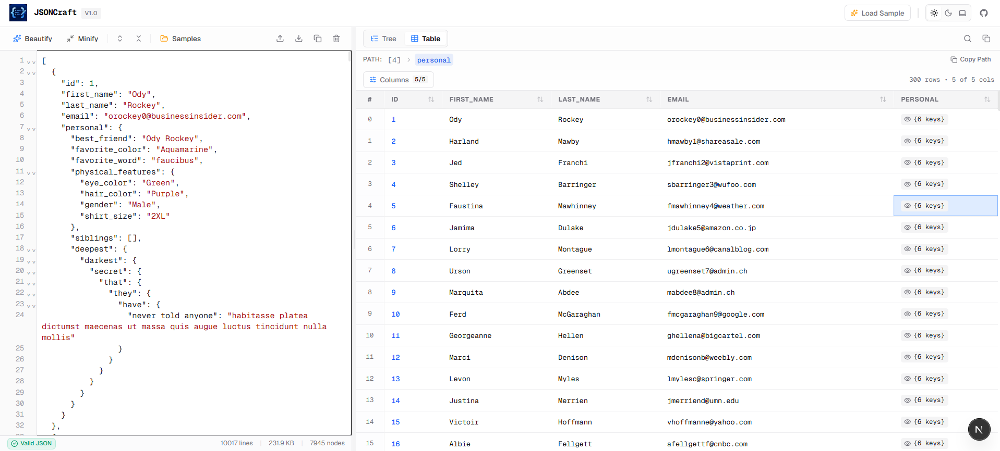
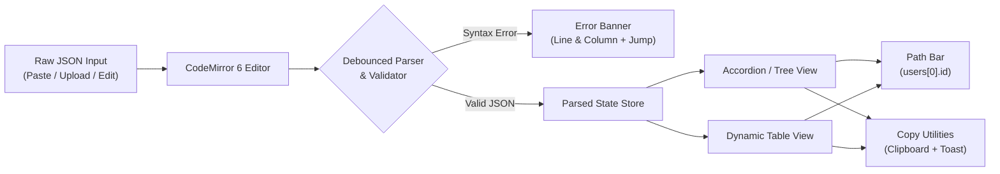

<div align="center">

  

  # JSONCraft

  **A fast, clean, and modern online JSON editor, visualizer, and analyzer built for developers.**

  [](https://jsoncraft.vercel.app)
  [](https://github.com/CodeFiroz/jsoncraft)
  [](https://nextjs.org/)
  [](https://react.dev/)
  [](https://www.typescriptlang.org/)
  [](https://tailwindcss.com/)
  [](./LICENSE)

  <p align="center">
    <a href="https://jsoncraft.vercel.app"><strong>🌐 Try Live Demo</strong></a> •
    <a href="#-features">✨ Features</a> •
    <a href="#-how-it-works">⚙️ How It Works</a> •
    <a href="#-keyboard-shortcuts">⌨️ Shortcuts</a> •
    <a href="#-getting-started">🚀 Getting Started</a> •
    <a href="./plan.md">📋 Specification</a>
  </p>

  <br />

  

</div>

---

## 📖 Overview

**JSONCraft** is a professional-grade developer utility designed to make inspecting, formatting, navigating, and debugging JSON effortless. Built with Next.js 16, TypeScript, CodeMirror 6, and Tailwind CSS v4, it replaces cluttered, ad-ridden online formatters with an elegant, responsive, and privacy-conscious split-screen developer workspace.

All processing is executed **100% locally in your browser**—no server uploads, no analytics tracking on your payloads, and no risk of leaking sensitive tokens, database dumps, or configuration payloads.

---

## 🚀 Live Demo

Experience the full interactive workspace live on Vercel:

👉 **[https://jsoncraft.vercel.app](https://jsoncraft.vercel.app)**

---

## ✨ Features

### 🖥️ Split-Screen Responsive Workspace
- **Customizable Split Ratio:** Default 40% Left (Editor) and 60% Right (Viewer) layout with smooth, draggable resize handles powered by `react-resizable-panels`.
- **Viewport Locked:** Desktop workspace fits the screen (`h-screen overflow-hidden`) with zero unwanted body scrollbars.
- **Mobile Optimized:** Automatically transitions to segmented tabs (`Editor` / `Viewer`) on smaller screens for seamless mobile use.

### 📝 Advanced CodeMirror 6 JSON Editor
- **Rich Code Editing:** JSON syntax highlighting, line numbers, automatic bracket matching, active line highlight, code folding, and smart indentation.
- **Instant Actions Toolbar:**
  - **Beautify (Format):** Cleanly formats JSON with 2-space indentation.
  - **Minify (Compact):** Strips unnecessary whitespace and carriage returns for minimal payload size.
  - **Fold / Unfold All:** Rapidly collapse or expand all nested blocks in the code editor.
  - **Copy JSON:** One-click copy with sonner notification feedback.
  - **Clear Workspace:** Quick clear with safety confirmation modal to protect large unsaved edits.
  - **File Upload & Download:** Drag & drop or upload `.json`/`.txt` files, or download edited contents as `data.json`.
- **Live Diagnostics & Safe Validation:**
  - Real-time syntax validation with accurate line and column detection.
  - Non-destructive: Invalid syntax shows an actionable error banner with "Jump to line" while preserving the prior valid viewer state.
- **Payload Statistics Bar:** Displays file size (bytes/KB), total line count, character count, total node count, and nesting depth.

### 🔍 Dual-Mode Interactive JSON Viewer
Effortlessly switch between tree exploration and tabular data visualization:

#### 1. Accordion / Tree View (Default)
- **Collapsible Hierarchies:** Expand and collapse individual objects and arrays at will.
- **Global Toggles:** One-click **Expand All** and **Collapse All** controls.
- **Data Type Syntax Colors:** Color-coded rendering for strings, numbers, booleans, null values, and object keys.
- **Item Badges:** Visual counter tags indicating array length or object key count.
- **Row-Level Copy:** Quick copy button on hover for individual primitive values or serialized objects/arrays.
- **Real-Time Search & Highlight:** Filter and highlight matching keys and values across the JSON structure with active match counters.

#### 2. Tabular Data View (Table Mode)
- **Automatic Column Detection:** Infers dynamic columns from arrays of objects.
- **Sorting & Filtering:** Sort rows by any column in ascending or descending order.
- **Column Visibility:** Selectively show or hide columns using the column visibility dropdown.
- **Nested Object Inspector:** Interactive cell modal allowing users to inspect nested objects and arrays without disrupting table alignment.
- **Multiple Structure Support:** Automatically renders single-object key/value tables, primitive lists, or arrays of objects.
- **Cell Hover Copy:** Copy any specific cell value instantly.

### 🧭 Dynamic JSON Path Navigation
- **Precise Accessor Paths:** Generates standard JavaScript/JSONPath accessors (e.g., `users[0].profile.slug`, `$.items[2].id`).
- **Interactive Breadcrumb Bar:** Updates dynamically as you click through tree nodes or table cells.
- **One-Click Path Copy:** Copy the exact accessor path directly to your clipboard for use in TypeScript, Python, or API queries.

### 🎨 Clean Monochromatic Theming
- **Tailored Themes:** Fully supported **Light**, **Dark**, and **System** themes powered by `next-themes`.
- **Developer Aesthetic:** 90% neutral zinc/slate monochromatic foundation with a restrained 10% blue accent for active states.
- **Theme-Synced Editor:** CodeMirror theme adapts dynamically between dark and light themes without re-rendering or losing cursor position.

### 🔒 100% Client-Side Privacy & Security
- Zero data ever leaves your computer.
- No network requests are sent with your JSON payloads.
- Completely safe for proprietary configs, production logs, API tokens, and credentials.

### ⚡ Built-in Sample Datasets
Includes instant-load presets:
1. **Users & Profiles:** Deeply nested objects and arrays.
2. **Products Catalog:** Multi-item array ideal for testing the Table View and column sorting.
3. **App Configuration:** Mixed booleans, strings, numbers, and environment flags.

---

## ⌨️ Keyboard Shortcuts

| Shortcut | Action | Scope |
|---|---|---|
| <kbd>Ctrl</kbd> / <kbd>Cmd</kbd> + <kbd>Shift</kbd> + <kbd>F</kbd> | Beautify / Format JSON | Editor |
| <kbd>Ctrl</kbd> / <kbd>Cmd</kbd> + <kbd>Shift</kbd> + <kbd>M</kbd> | Minify JSON | Editor |
| <kbd>Ctrl</kbd> / <kbd>Cmd</kbd> + <kbd>Shift</kbd> + <kbd>C</kbd> | Copy Editor JSON | Editor |
| <kbd>Ctrl</kbd> / <kbd>Cmd</kbd> + <kbd>A</kbd> | Select All Content | Editor |
| <kbd>Ctrl</kbd> / <kbd>Cmd</kbd> + <kbd>F</kbd> | Search within Editor | CodeMirror |

---

## ⚙️ How It Works



1. **Input & Edit:** Enter JSON directly into the CodeMirror editor or load a preset dataset.
2. **Debounced Parsing:** A custom hook parses the input with a 120ms debounce to maintain smooth typing performance on large files.
3. **Error Isolation:** If syntax errors occur, the editor highlights the offending line and column while keeping the last valid JSON in the right viewer to prevent layout flickering.
4. **Interactive Exploration:** Switch between the Tree View (for nested hierarchies) and the Table View (for arrays of records), click any node to track its JSON accessor path, or copy values directly.

---

## 🛠️ Technology Stack

| Category | Technology | Description |
|---|---|---|
| **Framework** | [Next.js 16 (App Router)](https://nextjs.org/) | Modern React full-stack framework with Turbopack |
| **Language** | [TypeScript 5](https://www.typescriptlang.org/) | Strongly typed codebase for reliability |
| **Styling** | [Tailwind CSS v4](https://tailwindcss.com/) | High-performance utility-first CSS |
| **Code Editor** | [CodeMirror 6](https://codemirror.net/) | Modern extensible code editor via `@uiw/react-codemirror` |
| **Panel Resizing**| [react-resizable-panels](https://github.com/bvaughn/react-resizable-panels) | Smooth, accessible split-view panes |
| **Theme System** | [next-themes](https://github.com/pacocoursey/next-themes) | Seamless dark, light, and system theme switching |
| **UI Components**| [Radix UI](https://www.radix-ui.com/) | Accessible primitives (Tooltips, Dialogs, Dropdowns) |
| **Icons** | [Lucide React](https://lucide.dev/) | Clean, consistent icons |
| **Notifications**| [Sonner](https://sonner.emilkowal.ski/) | Opinionated toast notifications |
| **Hosting** | [Vercel](https://vercel.com/) | Edge-optimized deployment platform |

---

## 📁 Project Structure

```text
jsoncraft/
├── app/
│   ├── favicon.ico             # Application favicon
│   ├── globals.css             # Tailwind v4 theme variables & base styles
│   ├── layout.tsx              # Root HTML & theme provider wrapper
│   └── page.tsx                # Main single-page application entry
├── components/
│   ├── editor/                 # CodeMirror editor, toolbars, error handling
│   │   ├── clear-confirm-modal.tsx
│   │   ├── codemirror-editor.tsx
│   │   ├── editor-panel.tsx
│   │   ├── editor-status.tsx
│   │   ├── editor-toolbar.tsx
│   │   └── json-error.tsx
│   ├── layout/                 # Application frame & resizable layout
│   │   ├── app-header.tsx
│   │   ├── resizable-layout.tsx
│   │   └── workspace.tsx
│   ├── shared/                 # Theme toggles & empty state indicators
│   ├── ui/                     # Radix UI wrapper primitives (button, dialog, tooltip, etc.)
│   └── viewer/                 # JSON visualization components
│       ├── column-visibility-menu.tsx
│       ├── json-path-bar.tsx
│       ├── json-table-cell.tsx
│       ├── json-table.tsx
│       ├── json-tree-node.tsx
│       ├── json-tree.tsx
│       ├── json-viewer.tsx
│       └── viewer-toolbar.tsx
├── hooks/
│   ├── use-json-parser.ts      # Debounced JSON validation & parse hook
│   └── use-json-selection.ts   # Active JSON node & path tracking
├── lib/
│   ├── json/                   # Core JSON manipulation utilities
│   │   ├── clipboard.ts        # Smart clipboard copy handlers
│   │   ├── formatter.ts        # Beautify & indent logic
│   │   ├── minifier.ts         # JSON minification logic
│   │   ├── parser.ts           # Safe parse, error locator & metrics calculation
│   │   ├── path-utils.ts       # Accessor path generator
│   │   └── samples.ts          # Preset JSON templates
│   └── utils.ts                # Styling class name helpers (cn)
├── public/
│   ├── logo.png                # JSONCraft brand logo
│   └── screenshot.png          # High-resolution application preview
├── plan.md                     # JSONCraft development specification
├── package.json
└── tsconfig.json
```

---

## 🚀 Getting Started

### Prerequisites

- **Node.js**: v18.0.0 or higher (Node v20+ recommended)
- **Package Manager**: `pnpm` (recommended), `npm`, `yarn`, or `bun`

### Installation

1. **Clone the repository:**
   ```bash
   git clone https://github.com/CodeFiroz/jsoncraft.git
   cd jsoncraft
   ```

2. **Install dependencies:**
   ```bash
   pnpm install
   # or: npm install
   ```

3. **Start the development server:**
   ```bash
   pnpm run dev
   # or: npm run dev
   ```

4. Open your browser and navigate to **[http://localhost:3000](http://localhost:3000)**.

### Production Build

To create an optimized production build:

```bash
pnpm run build
pnpm run start
```

---

## 🌐 Deploying to Vercel

The easiest way to deploy JSONCraft is using the [Vercel Platform](https://vercel.com):

1. Push your repository to GitHub.
2. Import the project in your Vercel Dashboard.
3. Vercel automatically detects Next.js:
   - **Framework Preset:** Next.js
   - **Build Command:** `next build`
   - **Output Directory:** `.next`
4. Click **Deploy** to go live in seconds!

Live Demo: **[https://jsoncraft.vercel.app](https://jsoncraft.vercel.app)**

---

## 👨‍💻 Author

- **Firoz** — [@CodeFiroz](https://github.com/CodeFiroz)
- Repository: [https://github.com/CodeFiroz/jsoncraft](https://github.com/CodeFiroz/jsoncraft)

---

## 📄 License

This project is licensed under the [MIT License](LICENSE) — feel free to use, modify, and distribute it for personal or commercial projects.
